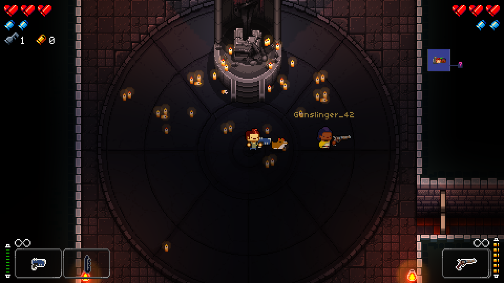
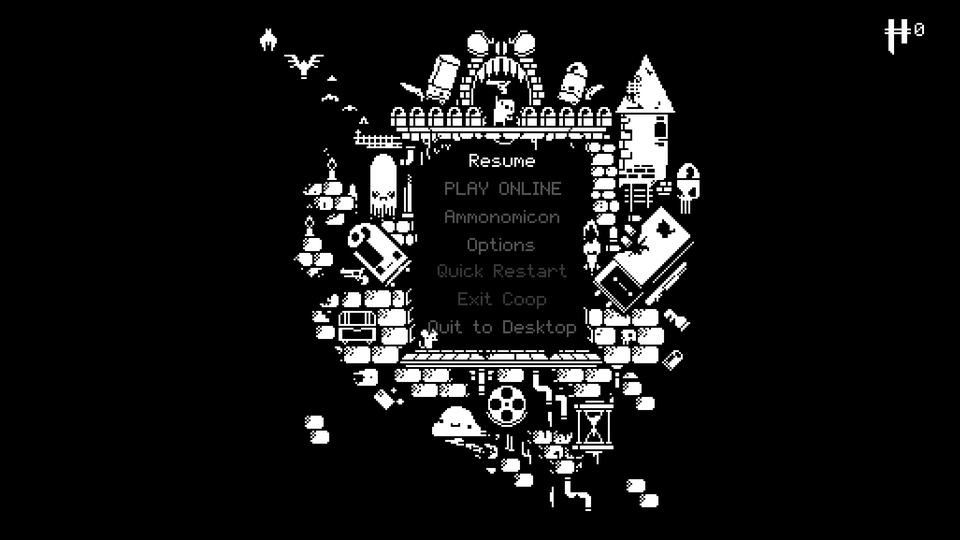
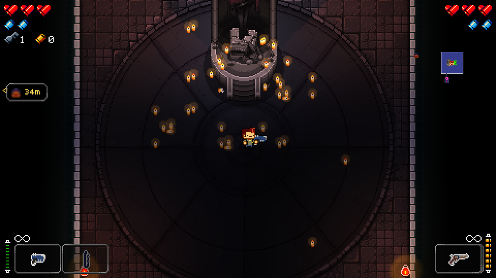

<p align="center">
  
</p>

<p align="center">
  
</p>

<h1 align="center">Enter The Gungeon Online Co-Op Mod</h1>

<p align="center">
  <b>Online co-op with independent cameras. Choose any character! Free and open source.</b>
</p>

<p align="center">
  
  
  
  
  
  <a href="https://ko-fi.com/hero88go"></a>
</p>

---

Gungeon's co-op has always been couch co-op: one shared camera, and player two is stuck as the Cultist. I wanted to play with a friend across the country, so I built this.

**Your own camera.** Each player plays on their own PC with their own screen, controller and HUD. Boss intros and kill cams still play for both of you.

**Choose any character.** Pilot, Convict, Marine, Hunter, Robot, Bullet, anyone you've unlocked. Both players can even pick the same one. No more forced Cultist.

**Play it your way: two co-op styles** (the host picks in Settings):
- *Classic* (default): vanilla rules. When one of you starts a fight, the other is pulled into the room, just like local co-op. You always fight together, but each of you keeps your own camera.
- *Explore*: split up as much as you like. Only one room can be in a fight at a time, so nobody starts a second fight alone, and nobody gets teleported.

**Built so it can't desync.** This was the thing I cared about most. A lot of online mods feel great for twenty minutes, then the two games quietly drift apart and you're shooting enemies your friend can't see. Enter The Gungeon Online Co-Op Mod is designed so that can't happen. The host runs the one real game and your PC follows it. Every second both games compare enemies, rooms, chests, health, money and inventories, and any difference is fixed on the spot. Your own character still reacts on the frame you press, with nothing waiting on the network.

**Runs can't be lost.**
- Short Wi-Fi hiccup: play just carries on.
- Someone drops for longer or their game crashes: the run pauses and waits for them, with no time limit. They reconnect and get their character, guns, items, health and spot back.
- The host crashes: the run is backed up every floor and every two minutes. The host restarts, picks *Resume saved run*, and you're back in.
- Need to stop? The host picks *Save run and quit*. Come back tomorrow or two weeks later, pick *Resume saved run*, and your friend rejoins with their own character and items.
- Quick restart is turned off online, so nobody can throw the run away by accident.

**Two ways to join.**
- **Invite code:** host the game and a short code is copied for you. Send it to your friend, they pick *Join*, done. Works on Steam, GOG and Epic.
- **Steam invite:** on Steam, pick *Invite Steam friend* and your friend accepts from the Steam overlay, like any Steam game.

**Easy to set up.** Steam, GOG and Epic copies all play together. A one-click installer finds your game. Pick *Play Online* from the pause menu (or hold Back + Start). It works with a controller.

**4-player support is in active development**. The netcode was built for 4 from day one; today it's 2 because that's what Gungeon itself supports. A Free for all style (fight in different rooms at the same time) is coming too.


<table>
  <tr>
    <td></td>
    <td></td>
  </tr>
  <tr>
    <td align="center"><sub>Play Online sits in the game's own pause menu.</sub></td>
    <td align="center"><sub>Host, and your invite code is copied for you.</sub></td>
  </tr>
  <tr>
    <td></td>
    <td></td>
  </tr>
  <tr>
    <td align="center"><sub>The host's screen...</sub></td>
    <td align="center"><sub>...and the friend's, at the same moment. Each camera follows its own player.</sub></td>
  </tr>
  <tr>
    <td></td>
    <td></td>
  </tr>
  <tr>
    <td align="center"><sub>Split up: a small tag at the screen edge points to your friend.</sub></td>
    <td align="center"><sub>Boss fights, bullets and all, on both screens.</sub></td>
  </tr>
</table>

## Install

Download the latest **`GungeonOnline-1.0.1.zip`** from [Releases](../../releases) and unzip it anywhere (right-click, Extract All). Close the game first. Then pick **either** way below. Both players need the same version.

### Option A: the installer (easiest)

1. Double-click **`Install Gungeon Online.bat`**.
2. It finds Enter the Gungeon by itself (every Steam library, GOG, Epic) and installs the mod. If it can't find the game, it asks you to pick the folder with `EtG.exe`.
3. Start the game. Done.

If Windows shows **"Windows protected your PC"**, click **More info**, then **Run anyway**. That warning appears for any downloaded .bat file. If you'd rather not run it, use Option B; it does exactly the same thing.

To remove the mod later, double-click **`Uninstall Gungeon Online.bat`**.

**Updating:** download the new zip and do the same thing again over your old install. Your settings and saved runs are kept. The game tells you when a new version is out.

### Option B: copy the files yourself

1. Open your game folder, the one with `EtG.exe`:
   - **Steam:** right-click Enter the Gungeon in your library, **Manage**, **Browse local files**.
   - **GOG Galaxy:** the game, the settings icon, **Manage installation**, **Show folder**.
   - **Epic:** usually `C:\Program Files\Epic Games\EnterTheGungeon`.
2. Open the unzipped download and go into the **`files`** folder.
3. Select everything in it (`BepInEx`, `winhttp.dll`, `doorstop_config.ini`, `.doorstop_version`) and copy it into the game folder. If Windows asks to replace files, say yes.
4. Start the game. Done.

To remove it, delete the `BepInEx\plugins\GungeonOnline` folder from the game folder. If you have no other BepInEx mods, you can also delete the `BepInEx` folder, `winhttp.dll`, `doorstop_config.ini` and `.doorstop_version`.

### Check it worked

Start the game and press pause: you should see **PLAY ONLINE** in the pause menu. If it's not there, see [Troubleshooting](#troubleshooting).

## Play

1. Start the game. Pause and pick **Play Online** (or hold **Back + Start**, or press **F8**).
2. One player picks **Host**. The invite code is copied for you: send it to your friend.
3. Your friend copies the code and picks **Join**.
4. Each player picks a character in their own Breach. The host walks into the Gungeon when everyone is ready.

If the join doesn't go through, your friend sends you their *reply code* and you pick *Let in friend*. If both routers are strict, use a VPN such as Tailscale or Radmin VPN and join with `ip:port`.

## Roadmap

- **4-player support is in active development**. The netcode was built for 4 from day one; today the game side supports 2.
- **Free for all co-op style:** fight in different rooms at the same time.

## Donate

My mods will always be free but donations are welcome on kofi! [ko-fi.com/hero88go](https://ko-fi.com/hero88go)

## Features

- **Any character for both players**, duplicates allowed. Pick in your own Breach.
- **Cross-store:** Steam, GOG and Epic copies play together (the game code is identical on all three).
- **Controller-first menu:** pick *Play Online* in the game's own pause menu, or hold **Back + Start**, or press **F8**.
- **Invite codes copied for you.** Host, send the code, your friend joins from their clipboard. Steam players can also invite from the friends list.
- **Gets through home routers:** automatic UPnP, hole punching, a reply-code fallback, and plain `ip:port` for VPNs like Tailscale or Radmin VPN.
- **Your own progress:** Hegemony credits, kills and unlocks earned in the run go into both players' saves.
- **Fair hits and falls:** whether a bullet hit you, or you fell into a pit, is decided on your own screen. If you saw it miss, it missed.
- **Per-player aim assist:** each player's own aim assist setting applies to their character on every PC.
- **Find each other:** a small tag at the screen edge points to your friend when they are off your screen. Optional name tags and your friend's crosshair, in the colors you pick.
- **Settings in plain words:** smoothing for your friend's character, correction speed, pause behaviour.
- **Send report:** one button sends me a report (and saves a copy to your Desktop) if anything looks off. Invite codes, IP addresses and your Windows user name are removed first.
- **One-click install:** the installer finds the game on Steam, GOG or Epic by itself.

## How it plays differently from couch co-op

- Cameras are independent. While one room is in combat, other rooms with enemies stay shut (setting: *One fight at a time*).
- Pausing opens your menu, but the game keeps running for your partner (setting: *Pausing stops everyone*).
- Talking to an NPC, a shrine or a shop takes over only the screen of the player who is talking.
- The exit elevator leaves when everyone is inside, on every PC together.

The full list is in [docs/COOP-INTERACTIONS.md](docs/COOP-INTERACTIONS.md).

## Made from scratch

Enter The Gungeon Online Co-Op Mod is original work. **It contains no code from GungeonTogether or any other Gungeon multiplayer mod.** Nothing was copied, ported or adapted from them, and no assets or files from them were used. Before starting I looked at GungeonTogether once, to see what already existed, and decided to build my own instead. The full git history shows the project being built up from an empty repository. Details: [docs/CLEAN-ROOM.md](docs/CLEAN-ROOM.md).

## FAQ

**Does it use rollback netcode?**
No. Rollback means rewinding and replaying the whole game every time a late input arrives. Enter the Gungeon wasn't built for that: thousands of unseeded random rolls and coroutines would make two games drift apart. Enter The Gungeon Online Co-Op Mod uses host-authoritative netcode with local prediction instead. Your own character has zero added input delay (the same benefit rollback gives you), and the game cannot desync. Full rollback is being researched as a separate, later project.

**What about latency to my friend?**
Your own character is never delayed. Your friend's character, the enemies and the bullets show up about half your ping behind. The mod's own work costs about 0.2 ms per frame on the host.

**Can more than 2 people play?**
Not yet. Enter the Gungeon itself supports two players. The netcode is written for more (a slot array and star topology), and 3 to 4 players is on the roadmap.

**Does it work on Steam Deck / Linux?**
Not tested yet.

**Do I need to own the game?**
Yes. Nothing from the game is included. Each player needs their own copy.

**Will it touch my saves?**
Your normal save is used and gets credit for runs you play online. Run backups go in `BepInEx/GungeonOnline/backups/`.

## Troubleshooting

- **No PLAY ONLINE in the pause menu:** the files went into the wrong folder. They must sit right next to `EtG.exe` (you should see `winhttp.dll` and the `BepInEx` folder beside it). Steam players: check you copied into the folder that **Browse local files** opened.
- **The installer window closes or does nothing:** use Option B, it does the same thing.
- **"Your friend has a different version":** both players need the same download. Get the latest from [Releases](../../releases).
- **Can't connect:** the joiner sends the host their *reply code* and the host picks *Let in friend*. If both routers are strict, use Tailscale or Radmin VPN and join with `ip:port`.
- Anything else: [open an issue](../../issues) and use *Send report* (Settings, Help and advanced).

## Status

Version 1.0.1 beta. **Found a bug? Please [open an issue](../../issues)** and use *Send report* (Settings, Help and advanced) if you can. Every report helps.

## Settings

All settings are in the online menu (*Settings*) and in `BepInEx/config/gungeononline.cfg`.

| Setting | Default | What it does |
|---|---|---|
| Smoothing of your friend | Auto | Buffer for your friend's inputs. Auto sizes it from the measured jitter. Your own character is never delayed. |
| Correction speed | 0.25 | How fast small position differences from the host are blended out. |
| Co-op style | Classic | Host only. Classic: a fight pulls your partner into the room, like local co-op. Explore: one fight at a time, nobody pulled. |
| Friend locator | Pickup tag | When your friend is off your screen, a small tag at the edge with their head and distance points the way. Or a speech bubble, or off. |
| Name tags | Off | Your friend's username above them, below their feet, or above and faint. With a color (gold, white, sky, rose, mint) and opacity (100%, 75%, 50%). |
| Connection warning | Top | Shows only when the connection is not great: top, top faint, corner, corner faint, or off. |
| Friend's crosshair | Off | The game's crosshair where your friend is aiming, in their name color. |
| Overlay size | Normal | Size of the connection warning, locator and name tags: small, normal or large. |
| Pausing stops everyone | Off | When on, the host pausing freezes the game for both players. |
| Port | 47624 | UDP port used when hosting. |

## For developers

- [docs/ARCHITECTURE.md](docs/ARCHITECTURE.md): the netcode model, frame order, who decides what.
- [docs/COOP-INTERACTIONS.md](docs/COOP-INTERACTIONS.md): every co-op difference and where it is handled.
- [CONTRIBUTING.md](CONTRIBUTING.md): building and tests.

```
dotnet build src/GungeonOnline -c Release -p:GameDir="<game folder with BepInEx>"
dotnet run --project tests/NetTests -c Release
```

## Credits

Made by **Hero88go**. Built on [BepInEx](https://github.com/BepInEx/BepInEx) and [HarmonyX](https://github.com/BepInEx/HarmonyX) ([third-party notices](THIRD-PARTY-NOTICES.md)).

Enter the Gungeon is made by Dodge Roll and published by Devolver Digital. Enter The Gungeon Online Co-Op Mod is an unofficial fan project and is not affiliated with or endorsed by them. Buy the game, it's great.

## License

MIT. See [LICENSE](LICENSE).
