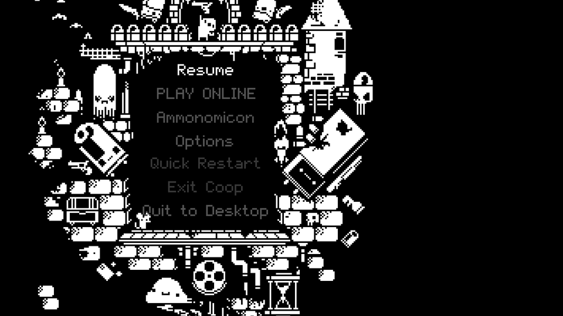
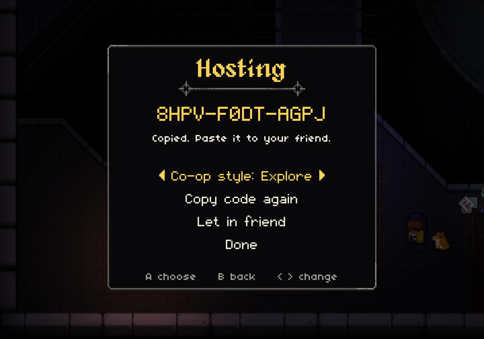
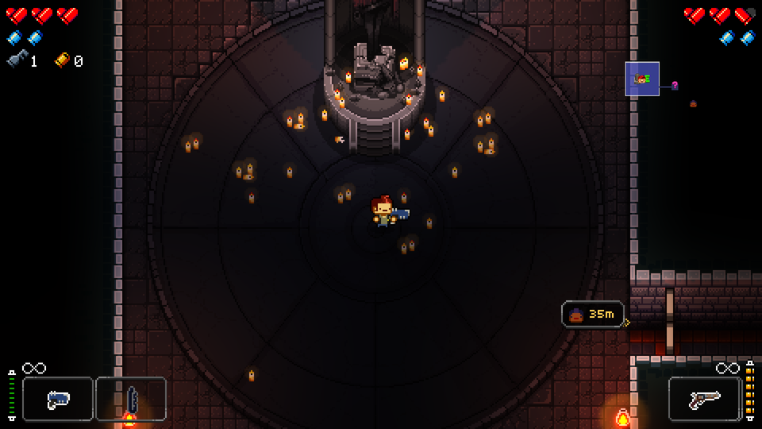
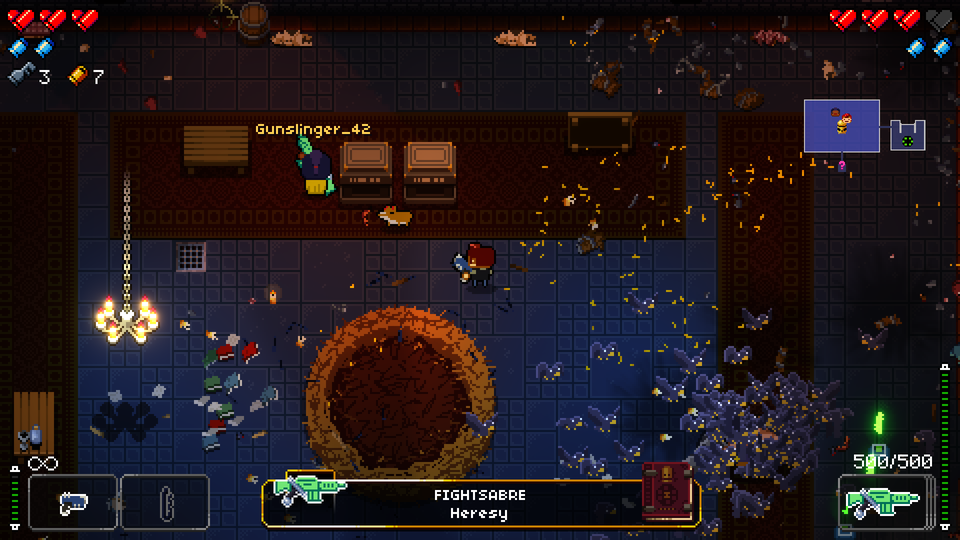
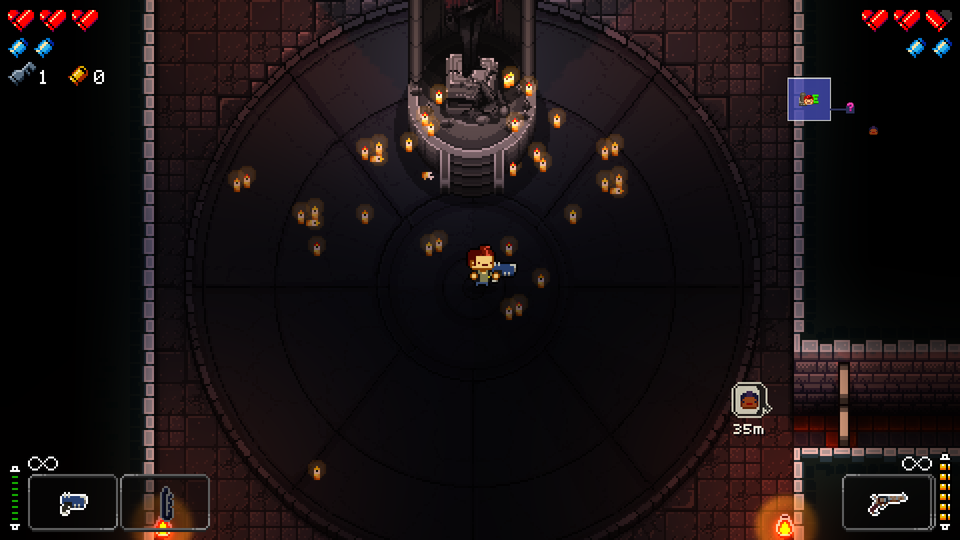

<p align="center">
  
</p>

<h1 align="center">Enter The Gungeon Online Co-Op Mod</h1>

<p align="center">
  <b>Online co-op for Enter the Gungeon. Your own camera. No input lag on your own character. No desyncs.</b>
</p>

<p align="center">
  
  
  
  
  
  <a href="https://ko-fi.com/hero88go"></a>
</p>

---

Enter the Gungeon's co-op is couch co-op: one screen, one camera, and player two is stuck as the Cultist. **Enter The Gungeon Online Co-Op Mod** turns it into real online co-op. Each player plays on their own PC, with their own controller, their own camera and any Gungeoneer they like, through the full run.

<table>
  <tr>
    <td></td>
    <td></td>
  </tr>
  <tr>
    <td align="center"><sub>The host's screen...</sub></td>
    <td align="center"><sub>...and the friend's screen, at the same moment. Each camera follows its own player.</sub></td>
  </tr>
</table>

## Install

1. Download `GungeonOnline.zip` from [Releases](../../releases) and unzip it anywhere.
2. Close the game and double-click **`Install Gungeon Online.bat`**. It finds Enter the Gungeon by itself (every Steam library, GOG, Epic) and installs BepInEx and the mod. If it can't find the game, it asks for the folder.
3. To remove it later, double-click **`Uninstall Gungeon Online.bat`**.

**Manual install (no .bat):**
1. Unzip `GungeonOnline.zip`.
2. Open your game folder, the one with `EtG.exe`. Steam: right-click Enter the Gungeon, Manage, Browse local files. GOG Galaxy: the game, Manage installation, Show folder.
3. Copy everything inside the zip's `files` folder into the game folder (the `BepInEx` folder, `winhttp.dll` and `doorstop_config.ini`).
4. Start the game. To uninstall, delete `BepInEx/plugins/GungeonOnline` (or the whole `BepInEx` folder and `winhttp.dll`).

Both players need the same version of the mod. The game tells you if they differ.

## Play

1. Start the game. Pause and pick **Play Online** (or hold **Back + Start**, or press **F8**).
2. One player picks **Host**. The invite code is copied for you: send it to your friend.
3. Your friend copies the code and picks **Join**.
4. Each player picks a character in their own Breach. The host walks into the Gungeon when everyone is ready.

If the join doesn't go through, your friend sends you their *reply code* and you pick *Let in friend*. If both routers are strict, use a VPN such as Tailscale or Radmin VPN and join with `ip:port`.

## Roadmap

- **4-player support is in active development** and it is the next thing coming. The netcode was built for 4 from day one; today the game side supports 2.
- **Free for all co-op style:** fight in different rooms at the same time.

## FAQ

**Does it use rollback netcode?**
No. Rollback means rewinding and replaying the whole game every time a late input arrives. Enter the Gungeon wasn't built for that: thousands of unseeded random rolls and coroutines would make two games drift apart. Enter The Gungeon Online Co-Op Mod uses host-authoritative netcode with local prediction instead. Your own character has zero added input delay (the same benefit rollback gives you), and the game cannot desync. Full rollback is being researched as a separate, later project.

**What about latency to my friend?**
Your own character is never delayed. Your friend's character, the enemies and the bullets show up about half your ping behind. The mod's own work costs about 0.2 ms per frame on the host.

**Can more than 2 people play?**
Not yet. Enter the Gungeon itself supports two players. The netcode is written for more (a slot array and star topology), and 3 to 4 players is on the roadmap.

**Does it work on Steam Deck / Linux?**
Not tested yet.

**Do I need to own the game?**
Yes. Nothing from the game is included. Each player needs their own copy.

**Will it touch my saves?**
Your normal save is used and gets credit for runs you play online. Run backups go in `BepInEx/GungeonOnline/backups/`.

## Why it feels good

### Independent cameras
Nobody drags the other player's screen around. Explore and loot cleared rooms on your own while your friend does the same. Nobody is pulled into a fight they didn't walk into, and the screen never stops you at the edge because your partner went the other way. Boss intros and kill cams still play for both players, like in vanilla.

### No input lag on your own character
Your Gungeoneer reacts on the frame you press, on your own PC. Movement, aiming, dodge rolls and shots never wait for the network. The host replays your inputs on its side and smooths away any small difference. Your friend's character, the enemies and the bullets arrive as fast as the connection allows: packets are applied the frame they land, nothing is held back to batch, and inputs are sent redundantly so a lost packet costs nothing.

### Classic or Explore: the host picks
- **Classic** (default): vanilla rules. When one of you starts a fight, the other is pulled into the room, just like local co-op. Each of you keeps your own camera.
- **Explore**: split up as much as you like. Only one room can be in a fight at a time, so nobody starts a second fight alone, and nobody gets teleported.

### Built so it cannot desync
A lot of online mods feel great for twenty minutes and then the two games quietly split apart. Here one game is the truth: the host runs the real run, and every other PC follows it. Every second both sides compare enemies, rooms, chests, health, money and inventories, and any difference is repaired on the spot. Long sessions stay in sync.

### A run is never lost
- **Short drop (up to 20 s):** play carries on once packets flow again.
- **Longer drop or a crash:** the host's world freezes with a banner and waits as long as it takes. Your game reconnects by itself and you get your character, items, health and spot back.
- **Host crash:** the host's game backs up the run at every floor and every two minutes. Restart, pick *Resume saved run*, and your friend rejoins.
- Quick restart is off online, so a stray button press can't throw a run away.

## Features

- **Any character for both players**, duplicates allowed. Pick in your own Breach.
- **Cross-store:** Steam, GOG and Epic copies play together (the game code is identical on all three).
- **Controller-first menu:** pick *Play Online* in the game's own pause menu, or hold **Back + Start**, or press **F8**.
- **Invite codes copied for you.** Host, send the code, your friend joins from their clipboard. Steam players can also invite from the friends list.
- **Gets through home routers:** automatic UPnP, hole punching, a reply-code fallback, and plain `ip:port` for VPNs like Tailscale or Radmin VPN.
- **Your own progress:** Hegemony credits, kills and unlocks earned in the run go into both players' saves.
- **Fair hits and falls:** whether a bullet hit you, or you fell into a pit, is decided on your own screen. If you saw it miss, it missed.
- **Per-player aim assist:** each player's own aim assist setting applies to their character on every PC.
- **Find each other:** a small tag at the screen edge points to your friend when they are off your screen. Optional name tags and your friend's crosshair, in the colors you pick.
- **Settings in plain words:** smoothing for your friend's character, correction speed, pause behaviour.
- **Save report:** one button writes a report to your Desktop if anything looks off.
- **One-click install:** the installer finds the game on Steam, GOG or Epic by itself.

<table>
  <tr>
    <td></td>
    <td></td>
  </tr>
  <tr>
    <td align="center"><sub>Play Online sits in the game's own pause menu.</sub></td>
    <td align="center"><sub>Host and your invite code is copied for you.</sub></td>
  </tr>
  <tr>
    <td></td>
    <td></td>
  </tr>
  <tr>
    <td align="center"><sub>Drawn with the game's own fonts and frames. Works with a controller.</sub></td>
    <td align="center"><sub>The default locator: your friend's head and distance at the screen edge.</sub></td>
  </tr>
  <tr>
    <td></td>
    <td></td>
  </tr>
  <tr>
    <td align="center"><sub>Boss fights, bullets and all, on both screens.</sub></td>
    <td align="center"><sub>Friend off screen? A small tag at the edge points the way.</sub></td>
  </tr>
</table>

## How it plays differently from couch co-op

- Cameras are independent. While one room is in combat, other rooms with enemies stay shut (setting: *One fight at a time*).
- Pausing opens your menu, but the game keeps running for your partner (setting: *Pausing stops everyone*).
- Talking to an NPC, a shrine or a shop takes over only the screen of the player who is talking.
- The exit elevator leaves when everyone is inside, on every PC together.

The full list is in [docs/COOP-INTERACTIONS.md](docs/COOP-INTERACTIONS.md).

## Made from scratch

Enter The Gungeon Online Co-Op Mod is original work. **It contains no code from GungeonTogether or any other Gungeon multiplayer mod.** Nothing was copied, ported or adapted from them, and no assets or files from them were used. Before starting I looked at GungeonTogether once, to see what already existed, and decided to build my own instead. The full git history shows the project being built up from an empty repository. Details: [docs/CLEAN-ROOM.md](docs/CLEAN-ROOM.md).

## Status

Version 1.0 beta. Every automated check in [VALIDATION.md](VALIDATION.md) passes. Those checks run two hidden game instances on one PC, with a simulated 70 ms connection, 240 fps and 200 fps, through fights, bosses, shops, deaths, floor changes, dropped connections, crashes and 30 minute sessions. What automation can't cover yet is real routers, Steam invites and human hands on controllers: that's what the first public sessions are for. **Found a bug? Please [open an issue](../../issues)** and attach the file from *Save report* (Settings, Help) if you can. Every report helps.

## Settings

All settings are in the online menu (*Settings*) and in `BepInEx/config/gungeononline.cfg`.

| Setting | Default | What it does |
|---|---|---|
| Smoothing of your friend | Auto | Buffer for your friend's inputs. Auto sizes it from the measured jitter. Your own character is never delayed. |
| Correction speed | 0.25 | How fast small position differences from the host are blended out. |
| Co-op style | Classic | Host only. Classic: a fight pulls your partner into the room, like local co-op. Explore: one fight at a time, nobody pulled. |
| Friend locator | Pickup tag | When your friend is off your screen, a small tag at the edge with their head and distance points the way. Or a speech bubble, or off. |
| Name tags | Off | Your friend's username above them, below their feet, or above and faint. With a color (gold, white, sky, rose, mint) and opacity (100%, 75%, 50%). |
| Connection warning | Top | Shows only when the connection is not great: top, top faint, corner, corner faint, or off. |
| Friend's crosshair | Off | The game's crosshair where your friend is aiming, in their name color. |
| Overlay size | Normal | Size of the connection warning, locator and name tags: small, normal or large. |
| Pausing stops everyone | Off | When on, the host pausing freezes the game for both players. |
| Port | 47624 | UDP port used when hosting. |

## For developers

- [docs/ARCHITECTURE.md](docs/ARCHITECTURE.md): the netcode model, frame order, who decides what.
- [docs/COOP-INTERACTIONS.md](docs/COOP-INTERACTIONS.md): every co-op difference and where it is handled.
- [CONTRIBUTING.md](CONTRIBUTING.md): building and tests.

```
dotnet build src/GungeonOnline -c Release -p:GameDir="<game folder with BepInEx>"
dotnet run --project tests/NetTests -c Release
```

## Credits

Made by **Hero88go**. Built on [BepInEx](https://github.com/BepInEx/BepInEx) and [HarmonyX](https://github.com/BepInEx/HarmonyX) ([third-party notices](THIRD-PARTY-NOTICES.md)).

Enter the Gungeon is made by Dodge Roll and published by Devolver Digital. Enter The Gungeon Online Co-Op Mod is an unofficial fan project and is not affiliated with or endorsed by them. Buy the game, it's great.

## License

MIT. See [LICENSE](LICENSE).

## Support

My mods will always be free but donations are welcome! [ko-fi.com/hero88go](https://ko-fi.com/hero88go)
