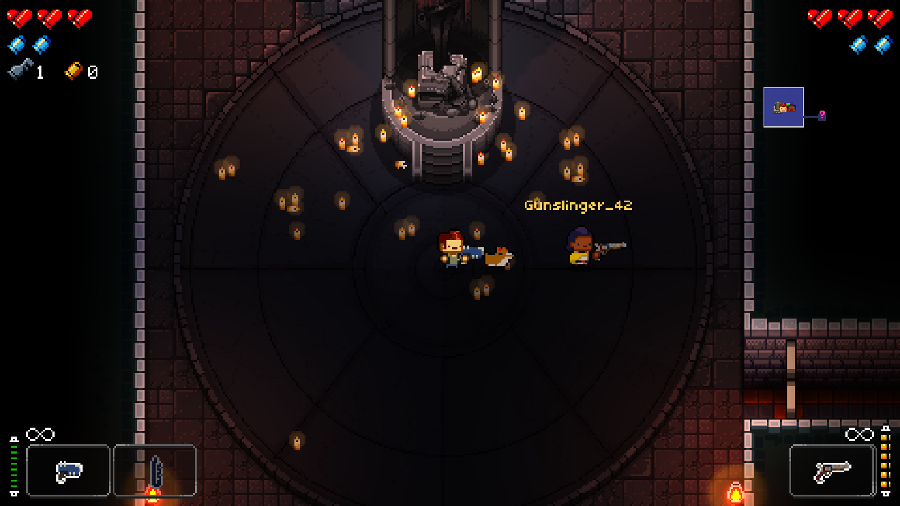
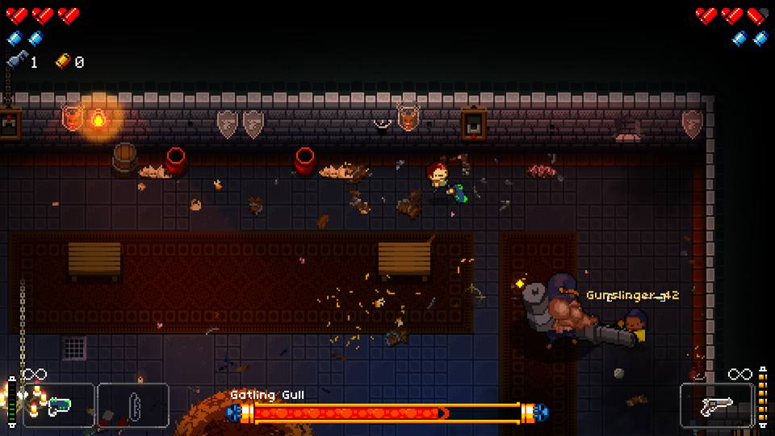
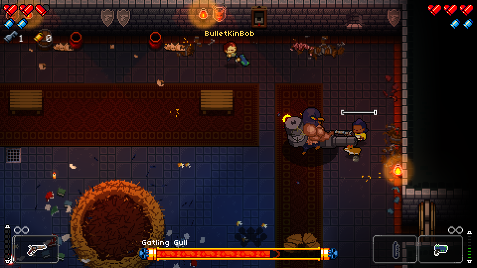
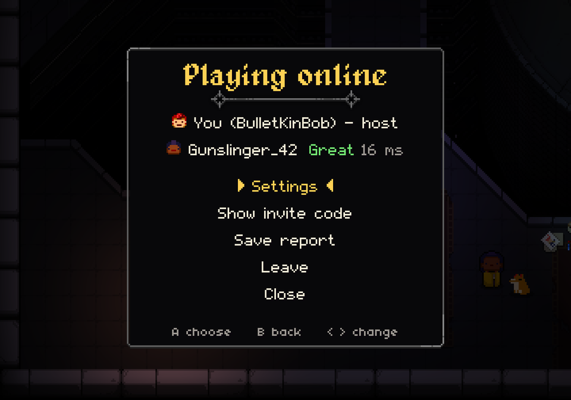

# Enter The Gungeon Online Co-Op Mod: real online co-op for Enter the Gungeon

I wanted to play Enter the Gungeon with a friend who lives across the country. The game's co-op is couch co-op: one screen, one shared camera, and player two is stuck as the Cultist. Remote Play works, but one player is watching a video stream of the other's game, with all the input lag that comes with it.

So I built **Enter The Gungeon Online Co-Op Mod**, a mod that turns Gungeon's co-op into real online co-op. Today version 1.0 is out, free and open source.

## Your own screen, your own camera

The first thing you notice is that the camera is yours. You explore one room while your friend loots the next one over. Nobody gets dragged into a fight they didn't walk into, and the screen never stops you at the edge because your partner went the other way. When a boss shows up, both of you are gathered for the intro and the kill cam, exactly like vanilla.

Each player has their own controller, their own HUD, and any Gungeoneer they like. Two Pilots? Fine.

## No input lag on your own character

This is the part I cared about most. Your Gungeoneer runs on your own PC and reacts on the frame you press. Moving, aiming, dodge rolling and shooting never wait for the network. The host replays your inputs on its side and quietly smooths out any small difference.

The rest (your friend's character, the enemies, the bullets) arrives as fast as the connection allows. Packets are applied the frame they land, nothing is held back to be batched, and every input packet also carries the last few inputs, so a lost packet costs nothing. The mod's own work costs about 0.2 milliseconds per frame.

## Why it doesn't use rollback

People will ask, so here it is. Rollback netcode rewinds the whole game and replays it whenever a late input arrives. It's great for fighting games, which are built to be replayed frame by frame. Enter the Gungeon isn't: it rolls thousands of random numbers that aren't tied to a seed and runs a thousand-odd coroutines. Two copies of it would drift apart.

Enter The Gungeon Online Co-Op Mod uses host-authoritative netcode with local prediction instead. You get the part of rollback that matters most, zero added delay on your own character, without the risk that comes with it. A full rollback version is a research project for later.

## It's built so it can't desync

The failure I was most afraid of: a session feels perfect for twenty minutes, then the two games quietly split and you're fighting enemies your friend can't see. Enter The Gungeon Online Co-Op Mod is designed so that can't happen. One game is the truth (the host's) and every other PC follows it. Every second, both sides compare enemies, rooms, chests, health, money and inventories, and any difference is repaired immediately.

## A run is never lost

Losing a good run to a Wi-Fi hiccup would be the worst. So:

- A short drop is bridged and play just carries on.
- If someone drops for longer or their game crashes, the host's world freezes with a banner and waits for as long as it takes. Their game reconnects by itself, and they get their character, guns, items, health and spot back.
- The host's game backs up the run at every floor and every two minutes. If the host crashes, they restart, pick *Resume saved run*, and their friend rejoins.
- Quick restart is turned off online, so a stray button can't throw a run away.

## Easy to start

1. Both players run the installer. It finds the game on Steam, GOG or Epic by itself.
2. Pause, pick **Play Online** (or hold Back + Start).
3. One player hosts. The invite code is already on the clipboard; send it.
4. The other player copies it and picks Join.

It gets through most home routers on its own (UPnP and hole punching), with a reply-code fallback and plain `ip:port` for VPNs. Steam, GOG and Epic copies all play together, since the game's code is the same on every store.

## The small things

- Whether a bullet hit you, or you fell into a pit, is decided on your screen. If you saw it miss, it missed.
- Hegemony credits, kills and unlocks earned in the run go into both players' saves.
- Each player's aim assist setting follows their own character.
- Talking to an NPC or a shop only takes over the talking player's screen.
- An optional "one fight at a time" rule keeps other rooms shut while one is in combat.

## Made from scratch

Enter The Gungeon Online Co-Op Mod is original work. It contains no code from GungeonTogether or any other Gungeon multiplayer mod: nothing copied, ported or adapted. I looked at GungeonTogether once before starting, to see what already existed, and decided to build my own. The whole git history is public, from the first commit up.

## Get it

- Download: https://github.com/Hero88go/GungeonOnlineCoOpMod/releases
- Source, docs and issues: https://github.com/Hero88go/GungeonOnlineCoOpMod
- License: MIT

Enter the Gungeon is made by Dodge Roll and published by Devolver Digital. Enter The Gungeon Online Co-Op Mod is an unofficial fan project, not affiliated with or endorsed by them. If you don't have the game yet, go buy it.

My mods will always be free but donations are welcome! [ko-fi.com/hero88go](https://ko-fi.com/hero88go)

*Hero88go*
